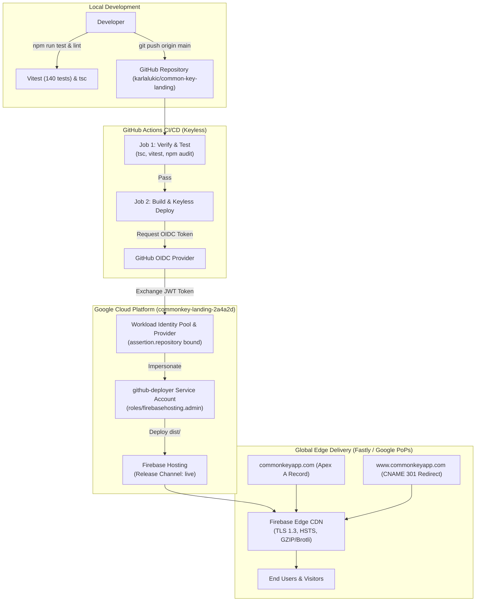

# Technical Architecture & Deployment Guide

This document details the system architecture, security framework, CI/CD pipeline, and DNS infrastructure for the **CommonKey Landing Page**.

---

## 1. System Architecture Overview

The CommonKey landing page is intentionally designed as an **isolated, static Single Page Application (SPA)** completely decoupled from the core CommonKey operational application backends. This guarantees:

- **Zero Attack Surface:** No dynamic runtime servers (Node/Express, Python, Docker) exposed to the public internet.
- **Maximum Availability & Resilience:** Pure static assets distributed across Google's worldwide Edge PoPs (Points of Presence) via Firebase Hosting.
- **Minimal Operational Cost:** Serviced comfortably within the Google Cloud / Firebase Spark tier with zero maintenance overhead.



---

## 2. Security & Zero-Trust Architecture

### 2.1 Keyless Workload Identity Federation (WIF)
Traditional CI/CD pipelines store long-lived Google Cloud Service Account JSON private keys in GitHub repository secrets. If compromised, these keys provide persistent access.

This project implements **Workload Identity Federation**:
1. When GitHub Actions triggers a build on `main`, GitHub's OIDC token service issues a cryptographically signed JSON Web Token (JWT) identifying the workflow run, commit SHA, and repository.
2. The `@google-github-actions/auth` step presents this JWT to Google Cloud's Security Token Service (STS).
3. Google Cloud verifies the signature against `https://token.actions.githubusercontent.com` and checks the provider condition:
   ```text
   assertion.repository == 'karlalukic/common-key-landing'
   ```
4. If verified, Google Cloud generates a short-lived (1 hour max) access token allowing the runner to temporarily impersonate `github-deployer@commonkey-landing-2a4a2d.iam.gserviceaccount.com`.
5. Zero secrets or keys can be leaked or rotated manually.

### 2.2 Least-Privilege IAM Roles
The `github-deployer` service account is strictly granted only the permissions necessary to deploy to Firebase Hosting:
- `roles/firebasehosting.admin`: Manage hosting releases, upload asset bundles, and release versions.
- `roles/serviceusage.serviceUsageViewer`: Read service enablement status during Firebase CLI deployment.

### 2.3 Edge Security Headers
Configured in [`firebase.json`](../firebase.json) and served on all responses:

```json
{
  "headers": [
    {
      "source": "**",
      "headers": [
        { "key": "Strict-Transport-Security", "value": "max-age=31556926; includeSubDomains; preload" },
        { "key": "X-Frame-Options", "value": "DENY" },
        { "key": "X-Content-Type-Options", "value": "nosniff" },
        { "key": "X-XSS-Protection", "value": "1; mode=block" },
        { "key": "Referrer-Policy", "value": "strict-origin-when-cross-origin" }
      ]
    }
  ]
}
```

---

## 3. CI/CD Pipeline Stages

The GitHub Actions workflow [`.github/workflows/deploy.yml`](../.github/workflows/deploy.yml) executes a strict quality gate before any release:

### Job 1: `verify` (Runs on PRs and Push to `main`)
1. **Clean Installation:** `npm ci`
2. **Static Type Checking:** `npm run lint` (`tsc --noEmit`)
3. **Automated Testing:** `npm test` (`vitest run`)
   - Smoke tests: Application mount and critical render trees.
   - Brand & Navigation: Desktop and responsive mobile drawer behaviors.
   - Interactive Logic: Tiered pricing calculator and Lot slider recalculation.
   - Accordion & UI: FAQ expand/collapse states.
   - Markdown & Articles: Metadata extraction and slug routing.
4. **Vulnerability Audit:** `npm audit --audit-level=high` (0 high or critical vulnerabilities).

### Job 2: `deploy` (Runs only on Push to `main`)
1. **Production Build:** `npm run build` (Compiles client bundle to `dist/`).
2. **WIF Authentication:** `google-github-actions/auth@v2` exchanges GitHub token for Google credentials.
3. **Atomic Edge Deployment:** `firebase-tools deploy --only hosting --non-interactive` uploads newly hashed asset files and switches the live release pointer with zero downtime.

---

## 4. Custom Domain & DNS Mapping

- **Apex Domain:** `commonkeyapp.com`
  - A Record: `199.36.158.100` (Google Firebase Anycast IP)
  - Ownership TXT Record: `hosting-site=commonkey-landing-2a4a2d`
- **Subdomain Redirect:** `www.commonkeyapp.com`
  - CNAME Record: `commonkey-landing-2a4a2d.web.app.`
  - Target: Automatically performs HTTP 301 redirect to `https://commonkeyapp.com`.
- **SSL / TLS Certificates:**
  - Automated provisioning via Google Trust Services (ACME HTTP-01 challenge).
  - Multi-region edge termination with automatic 90-day renewals.

---

## 5. Idempotent Infrastructure Setup Script

The entire GCP and WIF infrastructure was provisioned using the automated script:
[`scripts/setup-gcp-wif.sh`](../scripts/setup-gcp-wif.sh)

To provision another environment or inspect commands:
```bash
# Dry run to preview gcloud operations
./scripts/setup-gcp-wif.sh --dry-run

# Provision or update project infrastructure
./scripts/setup-gcp-wif.sh --project-id=commonkey-landing-2a4a2d
```
