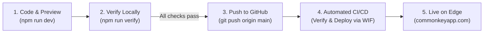

# CommonKey Developer Workflow & Release Guide

This guide details the complete development lifecycle for the **CommonKey Landing Page**: from local coding and testing through to automated GitHub Actions CI/CD deployment on Firebase Hosting.

---

## 🧭 The Core Development Philosophy

The development workflow follows a strict **"Local First, Test Before Push, Keyless Deploy"** model:



1. **Develop locally** with instant Hot Module Replacement.
2. **Verify locally** with a single command (`npm run verify`) to catch bugs, type issues, broken tests, or vulnerabilities before pushing.
3. **Push to `main`**, which triggers GitHub Actions to run the exact same checks and deploy keylessly to Firebase Hosting.
4. **Zero manual server management** and **zero static secrets/keys to rotate**.

---

## 🛠️ Step-by-Step Developer Workflow

### Step 1: Start the Local Development Server

Before writing code, start Vite in development mode:

```bash
npm run dev
```

- **Local URL:** [http://localhost:5173](http://localhost:5173)
- Features **Hot Module Replacement (HMR)**: edits to React components (`src/components/`), content (`src/data/`), or Tailwind styles reflect in your browser instantly.

---

### Step 2: Making Changes

The project code is organized into clear domains:

- **Landing Page Sections & UI:** [`src/components/`](../src/components/)
  - Header & Navigation: `src/components/Header.tsx`
  - Hero Section: `src/components/Hero.tsx`
  - Feature Modules (including The Research Hub): `src/components/Modules.tsx`
  - VIP Bonus Card: `src/components/BonusCard.tsx`
  - Interactive Pricing & ROI Calculator: `src/components/PricingCalculator.tsx`
  - FAQ Accordion: `src/components/FAQ.tsx`
  - Articles Directory & Detail Viewer: `src/components/ArticlesPage.tsx`, `src/components/ArticleView.tsx`
- **Educational Content & Articles:** [`src/data/articles.ts`](../src/data/articles.ts)
  - Articles, titles, slugs, reading times, tags, and Markdown bodies.
- **Brand Assets:** [`public/`](../public/)
  - `favicon.svg`, `robots.txt`, `sitemap.xml`.

---

### Step 3: Run the Pre-Push Verification Suite

> [!IMPORTANT]
> Always run the verification suite before pushing to GitHub. GitHub Actions enforces these exact checks as a required quality gate before deploying.

We've provided a single, fast command that executes all quality checks in under 15 seconds:

```bash
npm run verify
```

This single command automatically runs:

1. **TypeScript Type Check:** `npm run lint` (`tsc --noEmit`)
   - Ensures strict TypeScript compliance with zero type errors.
2. **Vitest Unit & Component Tests:** `npm test` (`vitest run`)
   - Runs all 140+ unit and component tests across 6 test suites:
     - Root App smoke & mount test
     - Brand identity & mobile menu navigation
     - Educational article metadata & markdown rendering
     - Interactive pricing calculator dynamic logic
     - FAQ accordion expansion & collapse logic
3. **Security Vulnerability Scan:** `npm audit --audit-level=high`
   - Scans dependencies to prevent high or critical security vulnerabilities.
4. **Production Build Compilation:** `npm run build` (`vite build`)
   - Bundles, minifies, and tree-shakes assets into the `dist/` directory to ensure the build compiles without syntax or asset errors.

#### Individual Commands (for targeted debugging)

If a specific check fails, you can run and debug it individually:

| Task | Command | Description |
| :--- | :--- | :--- |
| **Interactive Test Watcher** | `npm run test:watch` | Re-runs affected tests on every file save (ideal for TDD). |
| **Targeted Test File** | `npx vitest run src/App.test.tsx` | Runs tests only for a specific component. |
| **Type Check Only** | `npm run lint` | Quick TypeScript compiler check without running tests. |
| **Build Only** | `npm run build` | Compiles production assets into `dist/`. |
| **Preview Production Build** | `npm run preview` | Runs a local web server serving `dist/` at [http://localhost:4173](http://localhost:4173). |

---

### Step 4: Commit and Push to GitHub

Once `npm run verify` passes with zero errors:

1. **Check your modified files:**
   ```bash
   git status
   git diff
   ```

2. **Stage and commit your changes:**
   ```bash
   git add .
   git commit -m "feat: describe your change clearly"
   ```
   *(Use standard conventional prefixes: `feat:`, `fix:`, `docs:`, `style:`, `refactor:`, `test:`, `chore:`)*

3. **Push to the `main` branch:**
   ```bash
   git push origin main
   ```

---

### Step 5: Monitor Automated Deployment

Once pushed to `main`, GitHub Actions automatically takes over:

1. **View in Terminal:**
   ```bash
   # List recent workflow runs
   gh run list --limit 3

   # Watch the active deployment in real-time
   gh run watch
   ```

2. **View in Browser:**
   Visit the **[GitHub Actions Dashboard](https://github.com/karlalukic/common-key-landing/actions)**.

#### What GitHub Actions does automatically:
- **Job 1 (`Verify & Test`):** Runs `npm ci`, `tsc --noEmit`, `vitest run`, and `npm audit --audit-level=high` on an Ubuntu runner.
- **Job 2 (`Deploy to Firebase Hosting Live`):** 
  - Runs `npm run build`.
  - Authenticates keylessly to Google Cloud via Workload Identity Federation (WIF).
  - Deploys the compiled `dist/` directory directly to Firebase Hosting's `live` channel using `firebase-tools`.

---

### Step 6: Verify the Live Website

Once the GitHub Actions workflow finishes with a green checkmark (typically ~1 minute after push):

- **Primary Custom Domain:** [https://commonkeyapp.com](https://commonkeyapp.com)
- **Redirect Subdomain:** [https://www.commonkeyapp.com](https://www.commonkeyapp.com)
- **Firebase Default Site:** [https://commonkey-landing-2a4a2d.web.app](https://commonkey-landing-2a4a2d.web.app)

You can also verify from your terminal:
```bash
# Check apex domain returns HTTP/2 200
curl -sI https://commonkeyapp.com

# Check www returns HTTP/2 301 redirecting to apex
curl -sI https://www.commonkeyapp.com
```

---

## ⏪ Rollback & Disaster Recovery

If an unintended change is pushed to production, you have two instant recovery options:

### Option A: Quick Git Revert (Recommended)
Revert the commit on `main` and push; the CI/CD pipeline will automatically build and deploy the previous working version:
```bash
git revert HEAD --no-edit
git push origin main
```

### Option B: 1-Click Rollback in Firebase Console
Firebase Hosting retains release history with atomic snapshots:
1. Open the **[Firebase Hosting Console](https://console.firebase.google.com/project/commonkey-landing-2a4a2d/hosting/sites/commonkey-landing-2a4a2d)**.
2. Under **Release history**, locate the previous release.
3. Click the three dots (`⋮`) on the right side and select **Rollback**.
4. The edge CDN will immediately revert to serving the previous release snapshot within seconds.
